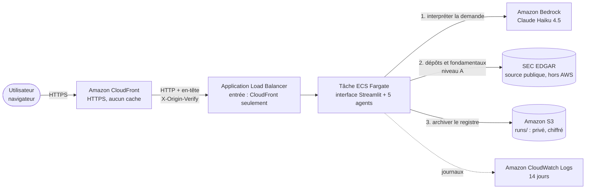
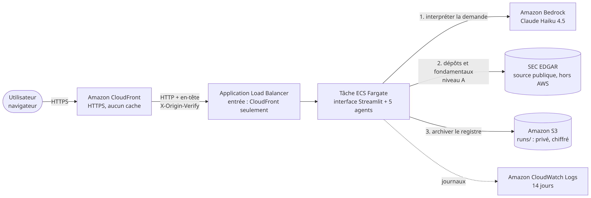
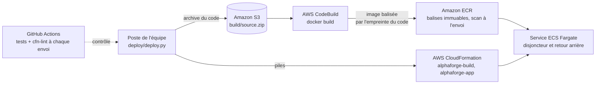
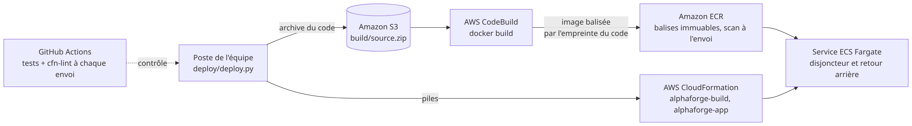

# Intégration AWS : architecture et justification

Section destinée à la documentation technique (PDF). Chaque valeur citée vient des modèles CloudFormation (`deploy/`), du code
(`alphaforge/`) ou de la configuration réelle du compte, relevée le 15 novembre 2026. Détail ressource par ressource :
[`deploy/README.md`](../deploy/README.md).

## 1. Ce que fait AWS dans la solution

AWS intervient à trois endroits du flux, chacun pour une raison précise. Aucun service n'est là pour faire nombre.

| Service | Rôle | Pourquoi ce service | Si le service est indisponible |
|---|---|---|---|
| **Amazon Bedrock** (Claude Haiku 4.5) | L'orchestrateur lui fait interpréter la demande en langage naturel : intention, actifs désignés (« l'or » → GLD, « la Banque Royale » → RY.TO), signaux de périmètre (prédiction, transaction, conseil). | Banc d'essai versionné (`deploy/bench_llm.py`, `deploy/bench_results.json`) : 108/108 pour Haiku 4.5, 105/108 pour Nova 2 Lite (signal « transaction » manqué), 30/36 pour les règles seules. | Repli automatique sur les règles, affiché sous le verdict. |
| **Amazon S3** | Chaque analyse archive son registre de preuves complet (`ledger.jsonl`) et un résumé (`summary.json`) sous `runs/AAAA-MM-JJ/<heure>-<empreinte>/`. | Traçabilité et rejeu : l'empreinte SHA-256 du registre est dans le chemin ; une analyse rejouée sur les mêmes données redonne la même empreinte. | Note « archive indisponible » ; l'analyse est affichée quand même. |
| **Amazon ECS Fargate, Elastic Load Balancing, Amazon CloudFront, Amazon ECR, AWS CodeBuild, AWS CloudFormation** | Hébergement public de l'interface, construction et publication de l'image, infrastructure décrite en code. | Une adresse HTTPS publique sans serveur à administrer ; un déploiement reproductible en une commande (`python3 deploy/deploy.py`). | — |

**Ce que le modèle de langage ne fait pas.** Bedrock ne calcule aucun chiffre et ne rend aucun verdict. Le code revérifie ce
qu'il propose : les actifs sont contrôlés contre l'univers, les poids sont relus dans le texte d'origine, et un signal de
périmètre détecté par les règles ne peut pas être retiré par le modèle (`alphaforge/orchestrator/request.py`).

## 2. Flux d'une analyse

Ordre dans la tâche : orchestrateur (Bedrock interprète la demande), enrichissement (SEC EDGAR), analyste quantitatif (données
du jeu de départ embarquées dans l'image), gouvernance, explicabilité, puis archive S3. Les calculs ne quittent jamais la tâche.

## 3. Construction et déploiement

Pas de Docker sur le poste : CodeBuild construit l'image. La balise est l'empreinte de l'archive du code, donc une image
désigne toujours le même code.

## 4. Bonnes pratiques appliquées

| Domaine | Mesure | Où |
|---|---|---|
| Moindre privilège | Le rôle de la tâche ne peut que `bedrock:InvokeModel` sur un seul modèle et `s3:PutObject` sous `runs/`. Aucune lecture S3, aucun autre service. Vérifié par simulation IAM : un autre modèle et la lecture S3 sont refusés. | `deploy/app-stack.yaml`, `TaskRole` |
| Aucun secret | Aucun identifiant AWS dans le code : boto3 utilise le rôle de la tâche. L'identification SEC est un paramètre de la pile, jamais un fichier du dépôt. | `alphaforge/app/pipeline.py`, paramètre `SecUserAgent` |
| Réseau | L'équilibreur n'accepte que la liste de préfixes CloudFront, et ne transmet qu'avec l'en-tête d'origine (sinon 403). La tâche n'accepte que l'équilibreur. Aucune entrée `0.0.0.0/0`. | `AlbSecurityGroup`, `ListenerRule`, `TaskSecurityGroup` |
| Données | Bucket privé (blocage de l'accès public, 4 options), chiffré (AES-256), HTTPS seulement, archives expirées après 60 jours. | configuration du bucket, relevée sur le compte |
| Image | Image Python 3.9 mise à jour au build (0 faille critique au scan ECR), utilisateur sans privilèges, contrôle de santé ; ECR garde les 5 dernières images. | `Dockerfile`, `build-stack.yaml` |
| Résilience | Délais courts vers AWS (connexion 3 s, lecture 8 s, 2 tentatives) ; replis affichés ; disjoncteur de déploiement avec retour arrière automatique. | `request.py`, `archive.py`, `app-stack.yaml` |
| Ressources | Une seule tâche (1 vCPU, 2 Go), CloudFront sans cache (interface dynamique), journaux conservés 14 jours. | `app-stack.yaml` |
| Reproductibilité | Infrastructure en code, vérifiée par `cfn-lint` à chaque envoi ; versions Python figées, identiques entre l'image et la CI. | `deploy/`, `.github/workflows/tests.yml` |

## 5. Preuves observables (à montrer dans la vidéo)

1. L'adresse https://d3rh9mi9cqh6mn.cloudfront.net/ (CloudFront).
2. Sous le verdict : « 🧠 Demande interprétée par Amazon Bedrock (global.anthropic.claude-haiku-4-5-20251001-v1:0) ».
3. Sous le verdict : « ☁ Registre archivé dans Amazon S3 : s3://alphaforge-runs-…/runs/… ».
4. Dans la console AWS : le service ECS en cours d'exécution, les deux piles CloudFormation, les archives du bucket.
5. Une demande comme « Lequel est le moins risqué entre l'or et les obligations américaines à long terme ? » : Bedrock relie
   « l'or » à GLD et « les obligations américaines à long terme » à TLT, ce que les règles seules ne savent pas faire.

## 6. Limites et améliorations envisagées

- **Fermeture du compte.** Le compte AWS de l'événement ferme le 16 novembre 2026 à 13 h 59 : la démo hébergée s'arrête. Le
  code reste utilisable hors AWS (règles et instantané SEC), et `deploy/deploy.py` redéploie tout sur un autre compte.
  Ce qui est perdu : l'adresse CloudFront, l'interprétation par Bedrock (remplacée par les règles, 30/36 au banc d'essai
  contre 108/108), l'archive S3 et les archives déjà écrites, et la console comme preuve. Ce qui reste : tous les agents,
  calculs, verdicts, explications et profils. Détail et vérification sans AWS : [README, « Après l'événement »](../README.md#après-lévénement).
- **Pas de limite de requêtes ni d'accès protégé.** L'adresse est publique, sans AWS WAF ni authentification : n'importe
  quel visiteur peut déclencher un appel Bedrock. Chaque analyse fait un appel au modèle, limité à 400 jetons de
  réponse, et une seule tâche Fargate traite les demandes ; mais aucun plafond global n'est fixé. Améliorations : une règle de limitation
  de débit WAF devant CloudFront, une authentification (Amazon Cognito) pour un usage réel, et une alerte AWS Budgets sur
  le compte.
- **Données des profils dans l'archive.** Le registre archivé dans S3 contient le profil utilisé, y compris le nom affiché
  et les raisons saisies en texte libre pour un profil créé dans l'interface. Les profils doivent rester fictifs : n'y
  saisir aucune donnée personnelle réelle. Le bucket est privé, chiffré, et les archives expirent après 60 jours.
- **Pas d'alarme.** Les journaux et les métriques du conteneur existent (CloudWatch, Container Insights), mais aucune alarme
  n'est définie. Amélioration : une alarme sur l'état de santé de la cible et sur les erreurs Bedrock.
- **HTTP entre CloudFront et l'équilibreur.** Le visiteur est toujours en HTTPS ; le dernier tronçon, interne à AWS, est en
  HTTP faute de nom de domaine et de certificat. Amélioration : domaine propre et certificat ACM sur l'équilibreur.
- **Une seule tâche.** Suffisante pour une démonstration ; une mise à l'échelle automatique serait nécessaire pour un usage
  réel.
